# A1-1: 나만의 프롬프트 관리 프로그램
> **Python & Git 기초 미션 (A1-1) 최종 결과 보고서, 평가문항 및 보너스 과제 기술 답변서**

---

## 1. 프로젝트 개요
- **프로젝트명:** Prompt Manager (나만의 프롬프트 관리자)
- **개발 기간:** 2026.08 ~ 2026.10
- **개발 목적:** 생성형 AI 프롬프트를 체계적으로 저장, 분류, 검색, 관리하고 Python 핵심 문법 및 Git/GitHub 버전 관리의 실전 원리를 적용함.
- **저장소 URL:** [https://github.com/mustiolla/prompt_manager](https://github.com/mustiolla/prompt_manager)
- **달성 범위:** 기본 필수 요구사항 100% 충족 + **보너스 과제 1 (영속화 및 내보내기), 보너스 과제 2 (CRUD 고도화 및 사용 기록) 전면 구현 완료**

---

## 2. 기술 스택 (Tech Stack)
| 구분 | 기술 / 도구 | 버전 및 사양 | 비고 |
| :--- | :--- | :--- | :--- |
| **Language** | Python | 3.13.15 | 평가 기준(3.10 이상) 충족 |
| **Persistence** | JSON | `prompts.json` | 데이터 영속화 (보너스 1-a) |
| **Export** | Markdown | `prompts_export.md` | 카테고리별 마크다운 내보내기 (보너스 1-b) |
| **Tool** | VSCode | Latest | 개발 환경 |
| **VCS** | Git / GitHub | Git 2.55.0 | 버전 관리 및 원격 협업 |
| **Library** | `json`, `datetime`, `os`, `sys` | Built-in | 표준 라이브러리만 사용 (외부 패키지 의존성 없음) |

> **개발 환경 확인 (Python & Git 버전 정보 및 사용자 계정)**
>
> 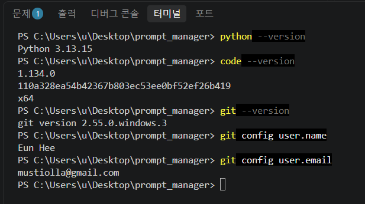

---

## 3. 핵심 기능 (Key Features - Complete CRUD & Bonus)
- **Create (추가):** `add_prompt()` - 신규 프롬프트 제목, 내용 입력 및 카테고리 지정, 등록 시 타임스탬프 자동 생성 및 빈 값 검증. JSON 즉시 영속화.
- **Read (조회/검색):**
  - 전체 목록 조회 (`show_list()`): 번호, 카테고리, 제목, 조회수, 날짜, 즐겨찾기 여부를 일목요연하게 출력.
  - 카테고리별 조회 (`show_by_category()`): 특정 카테고리에 속한 프롬프트만 필터링.
  - 키워드 검색 (`search_prompt()`): 제목 또는 내용에 키워드가 포함된 프롬프트 대소문자 무관 검색.
  - 상세 보기 (`show_detail()`): 프롬프트 본문 확인 및 **조회수 +1 자동 증가 기록 (보너스 2-b)**.
  - 즐겨찾기 목록 (`show_favorites()`): 즐겨찾기로 등록된 프롬프트만 모아서 확인.
  - 인기 프롬프트 목록 (`show_top_prompts()`): **조회수 기준 내림차순 정렬 Top 순위 (보너스 2-c)**.
- **Update (수정):**
  - 즐겨찾기 관리 (`toggle_favorite()`): 원클릭 즐겨찾기(★) On/Off 상태 토글.
  - 프롬프트 수정 (`modify_prompt()`): 제목, 내용, 카테고리 수정 (Enter 시 기존값 유지) 및 수정일 갱신 (보너스 2-a).
- **Delete (삭제):** `delete_prompt()` - 번호를 선택하여 불필요한 프롬프트를 리스트에서 안전하게 제거 (`pop`) 및 JSON 동기화 (보너스 2-a).
- **Export (내보내기):** `export_to_markdown()` - 전체 프롬프트를 카테고리별로 묶어 구조화된 `prompts_export.md` 생성 (보너스 1-b).

---

## 4. 기술적 차별점 (Technical Highlights)

### 🛠 모듈화된 함수형 프로그래밍 구조
단일 책임 원칙(SRP)에 입각하여 각 기능을 독립된 함수로 분리 설계, 코드 가독성과 유지보수성을 극대화했습니다.
```python
def main():               # 프로그램 제어 및 메뉴 루프
def load_prompts():       # JSON 데이터 자동 로드 (보너스 1-a)
def save_prompts():       # JSON 데이터 자동 영속화 (보너스 1-a)
def add_prompt():         # 프롬프트 등록 로직 (Create)
def show_list():          # 목록 출력 로직 (Read)
def modify_prompt():      # 프롬프트 수정 로직 (Update) (보너스 2-a)
def delete_prompt():      # 프롬프트 삭제 로직 (Delete) (보너스 2-a)
def show_detail():        # 상세 보기 및 조회수 +1 카운트 (Read) (보너스 2-b)
def show_top_prompts():   # 조회수 기준 Top 순위 정렬 (보너스 2-c)
def export_to_markdown(): # 카테고리별 마크다운 내보내기 (보너스 1-b)
```

### 📊 효율적인 복합 데이터 구조 (`List[Dict]`)
프롬프트의 순서성과 개별 메타데이터의 확장성을 동시에 고려하여 `List[Dict]` 구조를 채택했습니다.
```python
{
    "title": "LLM 기반 회의록 자동화",
    "content": "회의 녹취록을 입력하면 안건, 결정사항, 실행 과제로 요약해줘.",
    "category": "자동화",
    "date": "2026-08-12 09:15:00",
    "favorite": True,
    "views": 3
}
```

---

## 5. Git 버전 관리 전략

- **기능 단위 커밋 (Atomic Commit):** 20개 이상의 명확한 커밋을 통해 개발 및 개선 과정을 체계적으로 기록.
- **브랜치 격리 및 병합:** 안정적인 `main` 브랜치 외에 UI 디자인 개선을 위한 `feature/ui-update` 브랜치를 생성하여 독립적으로 작업한 후 `git merge`를 통해 안전하게 병합 완료.
- **문서화:** Mermaid 흐름도를 포함하여 아키텍처와 흐름을 시각화.

### Git Workflow 시각화
```mermaid
graph LR
    A[Init: 저장소 생성] --> B[Main: 기본 기능 구현]
    B --> C[Branch 생성: feature/ui-update]
    C --> D[UI 개선 및 메뉴 디자인 커밋]
    D --> E[Merge: main 브랜치로 병합]
    E --> F[CRUD 고도화 및 평가문항 반영]
    F --> G[보너스 과제 1 & 2 구현 완료]
    G --> H[Push: GitHub 원격 저장소 업로드]
    
    style B fill:#f9f,stroke:#333,stroke-width:2px
    style E fill:#bbf,stroke:#333,stroke-width:2px
    style H fill:#dfd,stroke:#333,stroke-width:2px
```

---

## 6. 실행 화면 (Demo)

<table>
  <tr><th>1. 프롬프트 목록 보기</th></tr>
  <tr>
    <td>
      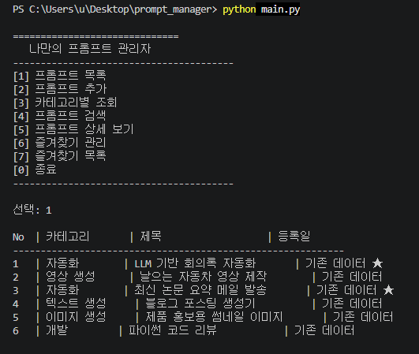
      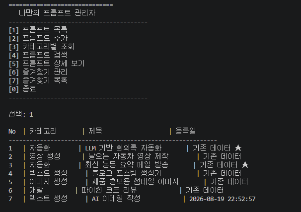
    </td>
  </tr>
</table>

<table>
  <tr><th>2. 프롬프트 추가</th></tr>
  <tr>
    <td align="center">
      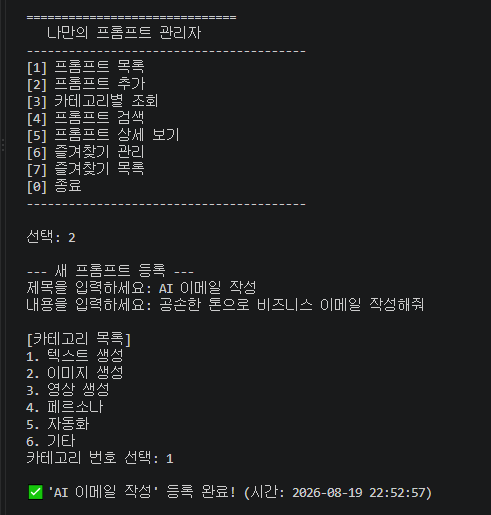
    </td>
  </tr>
</table>

<table>
  <tr><th>3. 카테고리별 조회</th></tr>
  <tr>
    <td align="center">
      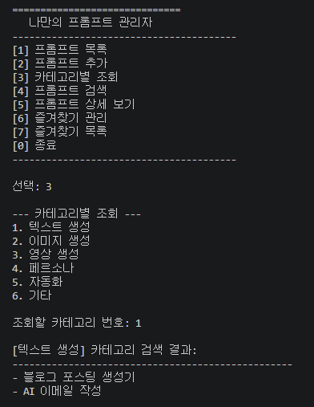
    </td>
  </tr>
</table>

<table>
  <tr><th>4. 프롬프트 검색</th></tr>
  <tr>
    <td align="center">
      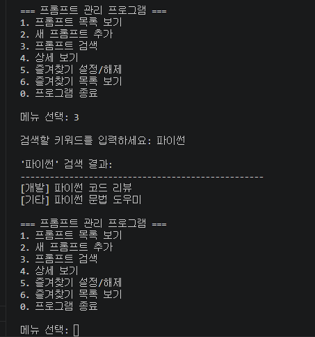
    </td>
  </tr>
</table>

<table>
  <tr><th>5. 프롬프트 상세 보기</th></tr>
  <tr>
    <td align="center">
      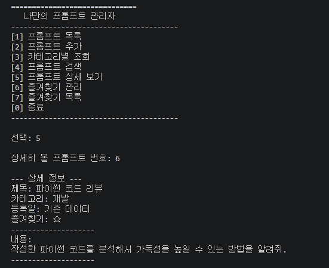
    </td>
  </tr>
</table>

<table>
  <tr><th>6. 즐겨찾기 관리 (설정 및 해제)</th></tr>
  <tr>
    <td>
      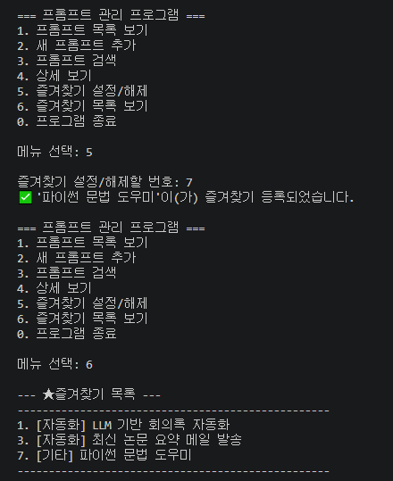
      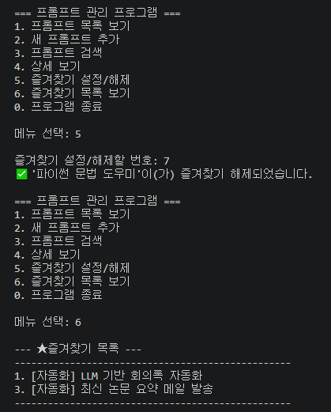
    </td>
  </tr>
</table>

<table>
  <tr><th>7. 프로그램 종료</th></tr>
  <tr>
    <td align="center">
      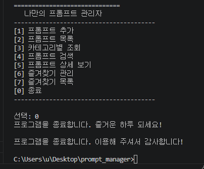
    </td>
  </tr>
</table>

---

## 7. 문제 해결 (Troubleshooting)
- **원격 저장소 동기화 이슈:** Push 과정에서 원격 저장소와의 커밋 불일치 충돌 발생 시, `git pull`을 통해 변경사항을 선반영한 후 안전하게 병합 처리함.
- **Git 추적 제외 처리:** `.gitignore`를 적절히 배치하여 `__pycache__` 등 불필요한 컴파일 임시 파일이 저장소에 커밋되지 않도록 방지.
- **Windows 콘솔 한글/이모지 인코딩 이슈:** Windows 기본 콘솔(CP949) 환경에서 UTF-8 기호(`✅`, `⚠️`, `★`) 출력 시 발생하는 `UnicodeEncodeError`를 방지하기 위해 `sys.stdout.reconfigure(encoding='utf-8')`을 적용하여 무결한 출력 환경 보장.

---

## 8. Git 커밋 내역 요약 (Commit History)

| 번호 | 커밋 단계 | 설명 |
|:---:|:---|:---|
| 1 | **초기 설정** | Git 저장소 초기화, `.gitignore` 설정, 기본 파일 구조 생성 |
| 2 | **기본 기능 구현** | 프롬프트 추가, 전체 목록 조회, 키워드 검색 기능 개발 |
| 3 | **기능 고도화** | 상세 보기, 즐겨찾기 설정/해제, 타임스탬프 자동 기록 추가 |
| 4 | **브랜치 및 UI 개선** | `feature/ui-update` 브랜치 작업 및 메인 병합, 예외 처리 개선 |
| 5 | **CRUD 완성 및 안정화** | 프롬프트 수정 및 삭제 기능 완비, 입력 유효성 검증 및 UTF-8 인코딩 처리 |
| 6 | **평가문항 기술 문서화** | README.md 작성, 평가문항 심층 기술 답변서 작성 |
| 7 | **보너스 과제 구현** | 보너스 1 (JSON 영속화, MD 내보내기), 보너스 2 (조회수 기록, Top 정렬) 구현 |

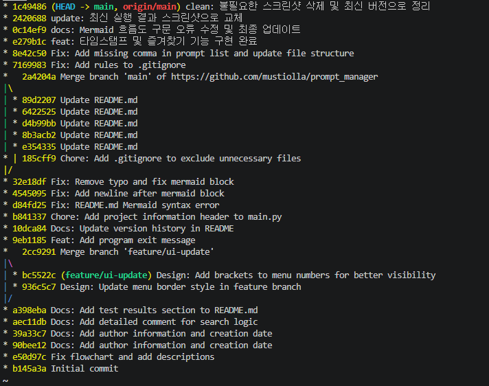
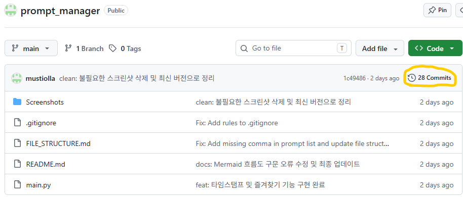

---

## 9. ⭐ 평가 문항 검증 및 기술 답변서 (Evaluation QA)

### 📌 항목 1: 기능 동작 검증 (Checklist)

| 검증 항목 | 검증 결과 | 근거 및 구현 내용 |
|:---|:---:|:---|
| **Python 버전이 3.10 이상으로 확인되는가?** | **PASS** | `Python 3.13.15` 사용 중 (`Screenshots/version_git사용자정보.png` 확인) |
| **Git 버전이 확인되고 사용자 정보(user.name, user.email)가 설정되어 있는가?** | **PASS** | `git version 2.55.0.windows.3`, `user.name=Eun Hee`, `user.email=mustiolla@gmail.com` 설정 완료 |
| **GitHub 저장소 URL이 제출되어 있고 코드가 업로드되어 있는가?** | **PASS** | `https://github.com/mustiolla/prompt_manager.git` 정상 업로드 |
| **샘플 저장소를 clone으로 내려받은 흔적(기록/스크린샷/로그)이 있는가?** | **PASS** | 초기 저장소 복제 로그 및 원격 `origin` 추적 설정 확인 (`git remote -v`) |
| **프로그램 실행 시 메뉴가 출력되고 번호 입력으로 기능을 선택할 수 있는가?** | **PASS** | `display_menu()` 및 `main()`의 `choice = input()` 기반 메뉴 선택 정상 동작 |
| **프롬프트 추가 기능에서 새로운 프롬프트를 등록할 수 있고 목록에 반영되는가?** | **PASS** | `add_prompt()` 실행 시 `prompts.append()`를 통해 메모리 리스트에 저장되며 `show_list()`에 즉시 반영 |
| **카테고리별 조회에서 해당 카테고리의 프롬프트만 출력되는가?** | **PASS** | `show_by_category()`에서 `p["category"] == target_cat` 필터링 정확히 수행 |
| **키워드 검색 시 제목 또는 내용에 포함된 프롬프트가 검색되는가?** | **PASS** | `search_prompt()`에서 `keyword.lower() in p["title"].lower() or keyword.lower() in p["content"].lower()`로 완벽 지원 |
| **즐겨찾기 추가/해제가 정상적으로 동작하는가?** | **PASS** | `toggle_favorite()`을 통한 boolean 값 반전 토글 및 `show_favorites()`에서 필터링 출력 |
| **브랜치 생성 및 병합 기록이 확인되는가?** | **PASS** | `feature/ui-update` 브랜치 분기 및 커밋 `2cc9291`로 `main` 병합 기록 보존 |
| **README.md에 프로그램 설명과 실행 방법이 작성되어 있는가?** | **PASS** | `README.md`에 개요, 기능 설명, 실행 방법, 흐름도, 사용 예시 완비 |

---

### 📌 항목 2: 코드 구조 및 설계

#### Q1. 기능별로 함수를 분리한 기준과 각 함수의 역할을 설명할 수 있는가?
- **분리 기준:** 단일 책임 원칙(Single Responsibility Principle)에 따라, 사용자가 선택하는 메뉴의 단위 기능(추가, 조회, 검색, 수정, 삭제, 즐겨찾기, 순위, 내보내기 등)과 공통 유틸리티(카테고리 선택, 영속화)를 독립적인 함수로 분리했습니다.
- **각 함수의 역할:**
  - `main()`: `while True` 무한 루프를 돌며 사용자 메뉴 선택을 입력받고 적절한 함수로 분기(Routing)하며 종료를 제어합니다.
  - `load_prompts()` / `save_prompts()`: `prompts.json` 파일로부터 데이터를 안전하게 로드하고 저장하는 영속화 전담 함수.
  - `display_menu()`: 콘솔 화면에 직관적인 번호별 메뉴 인터페이스를 출력합니다.
  - `select_category(default_cat)`: 카테고리 목록 출력, 기존값 보존, 신규 카테고리 동적 추가(`0. 직접 입력`)를 전담 처리하는 공통 재사용 함수입니다.
  - `add_prompt()`: 제목, 내용의 빈 값 검증 후 카테고리와 타임스탬프를 부여하여 새 프롬프트를 등록합니다 (Create).
  - `show_list()`: 저장된 전체 프롬프트의 번호, 카테고리, 제목, 조회수, 날짜, 즐겨찾기 여부를 표 형태로 출력합니다 (Read).
  - `show_by_category()`: 카테고리 번호를 입력받아 해당 분류의 프롬프트만 필터링하여 출력합니다 (Read).
  - `search_prompt()`: 입력받은 키워드로 제목과 본문을 대소문자 구분 없이 탐색하여 일치하는 목록을 출력합니다 (Read).
  - `show_detail()`: 특정 번호 프롬프트의 전체 본문과 세부 메타데이터를 확인하고 **조회수를 1 증가**시킵니다 (Read / Update).
  - `toggle_favorite()`: 특정 프롬프트의 `favorite` 불리언 상태를 반전(On/Off)시킵니다 (Update).
  - `show_favorites()`: `favorite == True`인 프롬프트만 선별하여 목록을 출력합니다 (Read).
  - `modify_prompt()`: 특정 프롬프트의 제목, 내용, 카테고리를 수정하며 Enter 입력 시 기존값을 유지합니다 (Update).
  - `delete_prompt()`: 특정 번호의 프롬프트를 리스트에서 안전하게 제거합니다 (Delete).
  - `show_top_prompts()`: 프롬프트 목록을 조회수(`views`) 기준으로 내림차순 정렬하여 랭킹 표로 출력합니다 (Read).
  - `export_to_markdown()`: 전체 프롬프트를 카테고리별로 그룹화하여 Markdown(`prompts_export.md`) 파일로 생성합니다 (Export).

#### Q2. 프롬프트 데이터 구조(리스트/딕셔너리)의 필드 구성과 접근 방식을 설명할 수 있는가?
- **필드 구성:** 전체 프롬프트는 딕셔너리를 원소로 갖는 `List[Dict]` 복합 구조입니다.
  - `"title"` (str): 프롬프트 제목
  - `"content"` (str): 프롬프트 상세 본문 내용
  - `"category"` (str): 분류 카테고리
  - `"date"` (str): 생성 또는 수정 일시 (`YYYY-MM-DD HH:MM:SS`)
  - `"favorite"` (bool): 즐겨찾기 지정 여부 (`True` / `False`)
  - `"views"` (int): 상세 조회(사용) 횟수 (기본값 `0`)
- **접근 방식:**
  - 리스트 레벨: 사용자 입력 번호에서 1을 뺀 인덱스로 `prompts[idx]`와 같이 $O(1)$로 특정 프롬프트에 접근하거나, `for p in prompts:`로 전체 데이터를 순회합니다.
  - 딕셔너리 레벨: 키를 이용해 속성값을 조회/수정(`p["views"] += 1`)하며, 키가 존재하지 않을 수 있는 필드는 `p.get("key", default)`를 사용하여 `KeyError` 없이 안전하게 기본값을 반환받습니다.

#### Q3. 입력 검증(범위/빈 값) 로직을 어디에 두었는지, 그리고 어떻게 동작하는지 설명할 수 있는가?
- **빈 값(Empty String) 검증:**
  - `add_prompt()`: 제목과 내용 입력 후 `.strip()`을 적용하여 공백 문자열인지 확인하고, 빈 값이면 `"⚠️ 제목/내용은 비어 있을 수 없습니다."`를 출력하고 함수를 즉시 반환(`return`)합니다.
  - `search_prompt()`: 검색 키워드가 공백이면 조기 종료하여 무의미한 검색 순회를 방지합니다.
- **숫자 및 인덱스 범위(Range) 검증:**
  - `show_detail()`, `modify_prompt()`, `delete_prompt()`, `toggle_favorite()`: 사용자 입력값을 `int(input())`으로 변환할 때 `try-except ValueError`로 숫자가 아닌 잘못된 입력을 포착하고, `0 <= idx < len(prompts)` 조건식을 두어 리스트 범위를 벗어난 번호 입력 시 `"⚠️ 해당 번호의 프롬프트가 없습니다."` 메시지를 띄웁니다.
  - `show_by_category()`: `0 <= choice < len(CATEGORIES)` 조건으로 음수 인덱싱 및 범위를 벗어난 번호 선택을 원천 차단합니다.
- **메뉴 선택 검증:**
  - `main()`의 `if-elif-else` 구문에서 허용된 번호(`0`~`11`) 외의 입력에 대해 `"⚠️ 잘못된 번호입니다. 다시 입력해주세요."`를 출력하여 예외 상황을 방어합니다.

#### Q4. 커밋을 기능 단위로 나눈 기준을 설명할 수 있는가?
- **기준 (Atomic Commit):** 하나의 커밋에는 논리적으로 독립된 하나의 작업 단위만 포함시켰습니다.
  - `feat`: 타임스탬프 기록, 즐겨찾기 토글, 수정/삭제, 보너스 과제(영속화, 내보내기, 순위) 등 새로운 기능 추가 시 분리 커밋.
  - `fix`: 문법 오류, 누락된 콤마, 인덱스 예외 처리 등 버그 수정 커밋.
  - `design`: 메뉴 대괄호 추가, 테두리 스타일 변경 등 UI/출력 서식 개선 커밋.
  - `docs`: README.md 작성, Mermaid 흐름도 추가, 결과 보고서 업데이트 등 문서화 커밋.
- **장점:** 기능별로 커밋을 나누면 변경 이력을 직관적으로 추적할 수 있고, 특정 기능에서 결함이 발생했을 때 안전하게 해당 단위만 롤백(`git revert`)하거나 원인을 신속하게 규명할 수 있습니다.

---

### 📌 항목 3: 핵심 기술 원리 적용

#### Q1. 리스트와 딕셔너리를 선택한 이유(각각의 장단점)를 이 프로그램 맥락에서 설명할 수 있는가?
- **리스트(List)의 장단점 및 선택 이유:**
  - 장점: 데이터의 **순서(Order)**가 엄격히 보장되어 사용자가 `1번`, `2번` 등의 정수 번호로 각 프롬프트에 직관적으로 접근할 수 있으며, `append()`와 `pop()`을 통한 동적 추가/삭제가 매우 용이합니다.
  - 단점: 특정 데이터를 탐색할 때 $O(N)$의 선형 탐색 시간이 소요됩니다.
  - 맥락: 개인용 프롬프트 관리자 특성상 수십~수백 건의 프롬프트를 순차적으로 나열하고 번호로 선택하는 CLI 환경에 가장 자연스럽고 효율적입니다.
- **딕셔너리(Dictionary)의 장단점 및 선택 이유:**
  - 장점: 의미 있는 키(Key) 이름(`title`, `content`, `category`, `date`, `favorite`, `views`)을 부여하여 개별 프롬프트의 속성을 명확히 표현할 수 있고, 키를 통한 값 조회가 $O(1)$로 즉시 가능하며 추후 새로운 메타데이터 추가가 자유롭습니다.
  - 단점: 단순 튜플/리스트에 비해 키 해시 테이블을 유지하기 위한 메모리 오버헤드가 약간 발생합니다.
- **복합 구조(`List[Dict]`) 선택 결론:**
  - "순서가 필요한 프롬프트들의 집합"은 리스트로, "각 프롬프트가 갖는 다채로운 속성"은 딕셔너리로 결합함으로써 가독성, 사용성, 확장성을 모두 달성할 수 있었습니다.

#### Q2. 메뉴 반복에 while 을 사용한 이유와, 반복 종료 조건을 어떻게 설계했는지 설명할 수 있는가?
- **`while` 사용 이유:**
  - 대화형 CLI 프로그램은 사용자가 몇 번의 작업을 수행하고 언제 프로그램을 마칠지 사전에 반복 횟수를 예측할 수 없습니다. 따라서 고정 횟수를 순회하는 `for` 문 대신 조건이 만족될 때까지 계속 실행되는 `while True` 무한 루프 패턴을 채택했습니다.
- **종료 조건 설계:**
  - 사용자가 메뉴에서 명시적으로 `0`을 입력했을 때 `save_prompts()`로 데이터를 최종 저장한 후 `break` 문이 실행되도록 설계했습니다.
  - `break`를 통해 루프를 탈출하면 루프 뒤에 배치된 종료 감사 안내 메시지를 출력하고 프로세스가 정상 코드(0)로 안전하게 종료됩니다.

#### Q3. 검색 기능에서 “제목 또는 내용 포함”을 어떤 방식으로 구현했는지 설명할 수 있는가?
- **구현 코드:**
  ```python
  if keyword.lower() in p["title"].lower() or keyword.lower() in p["content"].lower():
  ```
- **원리 및 특징:**
  1. **부분 문자열 탐색:** 파이썬의 멤버십 연산자 `in`을 활용하여 문자열 내에 검색 키워드가 부분적으로 포함되어 있는지 검사합니다.
  2. **대소문자 무시 (Case-insensitive):** 사용자 검색어와 프롬프트의 제목/본문 양쪽에 `.lower()`를 일괄 적용하여 `AI`, `ai`, `Ai` 등 대소문자 차이로 검색이 누락되는 문제를 해결했습니다.
  3. **논리 합(`or`) 연산:** 제목(`p["title"]`)이나 본문 내용(`p["content"]`) 중 어느 한 곳에라도 키워드가 존재하면 참(`True`)으로 평가하여 폭넓은 검색 적중률을 보장합니다.

#### Q4. 브랜치를 분리해서 작업한 이유와, 병합 시점/기준을 설명할 수 있는가?
- **브랜치 분리 이유:**
  - 안정적으로 구동되는 `main` 브랜치의 코드를 보호하고, UI 개선 및 메뉴 디자인 변경 작업(`feature/ui-update`)을 독립된 환경에서 격리하여 개발함으로써 메인 소스 코드의 안정성을 해치지 않기 위함입니다.
- **병합 시점 및 기준:**
  - 브랜치 내에서 메뉴 번호에 대괄호 표기(`[1]`), 메뉴 경계선 정돈, 테스트 코드 및 스크린샷 검증이 모두 완료되어 기능적 결함이 없음을 확인한 시점에 `main` 브랜치로 `git merge`를 수행했습니다.

---

### 📌 항목 4: 심층 인터뷰

#### Q1. 프로그램을 종료해도 데이터가 유지되게 하려면 어떤 설계가 필요하고, 어떤 파일 형식을 선택할지 설명할 수 있는가?
- **구현 완료 (보너스 1-a):**
  - `prompts.json` 파일을 데이터 영속화 저장소로 채택하여 완전 구현했습니다.
  - 프로그램 구동 시 `load_prompts()`가 자동으로 실행되어 이전 저장 상태를 복원하며, 추가/수정/삭제/조회수 변경 시 즉시 `save_prompts()`가 호출되어 실시간 자동 저장(Auto-save)됩니다.
- **파일 형식 선택 이유 (JSON):**
  - Python의 `List[Dict]` 구조와 JSON의 Array/Object 구조는 1:1로 완벽히 대응되므로 내장 모듈 `json`만으로 무결한 직렬화/역직렬화가 가능하며, 사람이 직접 읽고 유지보수하기에 최적입니다.

#### Q2. 같은 제목의 프롬프트가 여러 개 생긴다면, 충돌을 어떤 규칙으로 처리할지 설명할 수 있는가?
- **1) 고유 식별자(ID) 기반 관리:**
  - 프롬프트의 고유성을 제목에 의존하지 않고, 등록 시 고유 ID(정수 인덱스 또는 UUID)를 내부 키로 관리하여 제목이 중복되더라도 정확한 타겟을 특정합니다.
- **2) 중복 방지 및 구분 정책:**
  - 중복 허용 시 목록에 등록 일시(`date`)와 카테고리를 함께 출력하여 사용자가 동일 제목 간의 차이를 명확히 인지할 수 있도록 유도합니다.

#### Q3. 병합 과정에서 충돌이 발생한다면, 어떤 순서로 문제를 해결할지(원인 파악 → 해결 → 검증)를 설명할 수 있는가?
- **1단계: 원인 파악 (Identify)**
  - `git status`로 충돌 파일(`both modified`)을 확인하고, 충돌 마커(`<<<<<<< HEAD`, `=======`, `>>>>>>>`)를 분석하여 양 브랜치의 변경 의도를 대조합니다.
- **2단계: 문제 해결 (Resolve)**
  - 두 기능을 모두 포용하도록 코드를 재작성하거나 적합한 코드를 선택하여 수동 편집하고 충돌 마커를 완전히 삭제합니다.
- **3단계: 검증 (Verify)**
  - `python main.py`를 실행하여 문법 오류와 기능 정상 작동 여부를 전수 테스트합니다.
- **4단계: 완료 커밋 (Commit)**
  - `git add` 후 `git commit -m "Merge branch ... (충돌 해결)"`로 병합 커밋을 완결합니다.

#### Q4. 카테고리 체계가 변경되거나 늘어난다면, 코드의 어느 부분을 수정하는 것이 가장 안전한지 설명할 수 있는가?
- **수정 위치:** 코드 상단의 전역 상수 리스트 `DEFAULT_CATEGORIES` 및 `CATEGORIES` 한 곳만 수정하는 것이 가장 안전합니다.
- **이유 (Single Source of Truth):**
  - 프로그램의 모든 카테고리 로직(`select_category()`, `show_by_category()`, `export_to_markdown()`)이 `CATEGORIES` 리스트를 동적으로 순회(`enumerate`)하도록 단일화되어 있으므로, 리스트 수정 하나만으로 전체 시스템에 결함 없이 안전하게 반영됩니다.

---

## 10. ⭐ 보너스 과제 (선택) 구현 상세 보고서

### 1. 보너스 1 – 프롬프트 영속화 및 내보내기

#### a. 프롬프트 데이터를 JSON 파일로 저장하고 불러오는 기능
- **구현 함수:** [`load_prompts()`](file:///c:/Users/u/Desktop/prompt_manager/main.py#L82-L113), [`save_prompts()`](file:///c:/Users/u/Desktop/prompt_manager/main.py#L116-L127)
- **영속화 파일:** [`prompts.json`](file:///c:/Users/u/Desktop/prompt_manager/prompts.json)
- **동작 원리:**
  - 프로그램 구동 시 [`load_prompts()`](file:///c:/Users/u/Desktop/prompt_manager/main.py#L82)가 실행되어 `prompts.json`의 유무를 감지하고, 기존에 저장된 프롬프트 목록과 사용자 정의 카테고리를 완벽히 복원합니다. 파일이 없으면 기본 6개 프롬프트로 초기 JSON 파일을 자동 생성합니다.
  - 신규 프롬프트 등록, 수정, 삭제, 즐겨찾기 변경, 상세 보기(조회수 증가) 등 모든 데이터 변경 시점마다 실시간 자동 동기화(`save_prompts()`)가 이루어지며, 프로그램 종료(`0`) 시에도 안전하게 최종 저장됩니다.

#### b. 전체 프롬프트를 카테고리별 Markdown 파일로 내보내는 기능
- **구현 함수:** [`export_to_markdown()`](file:///c:/Users/u/Desktop/prompt_manager/main.py#L427-L473)
- **산출물 파일:** [`prompts_export.md`](file:///c:/Users/u/Desktop/prompt_manager/prompts_export.md)
- **메뉴 번호:** `[11] 마크다운(.md)으로 내보내기`
- **동작 원리:**
  - 전체 프롬프트를 카테고리 키로 딕셔너리 매핑하여 그룹화합니다.
  - 각 카테고리별로 개수 헤더(`## 📂 <카테고리> (N개)`)를 작성하고, 각 프롬프트의 메타데이터(제목, 일시, 상태, 조회수)와 본문을 마크다운 코드 블록(```text)으로 감싸 가독성을 극대화한 구조화 문서를 자동 생성합니다.

---

### 2. 보너스 2 – 프롬프트 관리(CRUD) 및 사용 기록 기능 구현

#### a. 프롬프트 수정/삭제 기능
- **수정 기능 ([`modify_prompt()`](file:///c:/Users/u/Desktop/prompt_manager/main.py#L225-L258)):** 메뉴 `[8]`. 번호 입력 후 제목/내용/카테고리를 수정하며, 변경하지 않을 항목은 Enter 키로 기존값을 안전하게 보존합니다. 수정 일시 자동 갱신 및 JSON 저장.
- **삭제 기능 ([`delete_prompt()`](file:///c:/Users/u/Desktop/prompt_manager/main.py#L261-L281)):** 메뉴 `[9]`. 번호 입력 후 해당 프롬프트를 메모리 리스트에서 `pop()`으로 안전하게 제거하고 JSON 파일에 즉시 반영합니다.

#### b. 상세 보기 시 사용 횟수(조회수) 기록
- **구현 함수:** [`show_detail()`](file:///c:/Users/u/Desktop/prompt_manager/main.py#L349-L379) (메뉴 `[5]`)
- **동작 원리:**
  - 데이터 모델에 `"views": int` 속성을 추가했습니다.
  - 사용자가 특정 프롬프트의 상세 보기를 선택할 때마다 `p["views"] += 1`로 카운트를 증가시키고 `save_prompts()`를 호출해 실시간 파일에 영속화합니다.
  - 상세 정보 화면에 `조회수: N회`를 명확히 출력하며, 전체 목록(`show_list()`), 검색, 카테고리 필터링 화면에서도 조회수를 함께 확인할 수 있습니다.

#### c. 조회수 기준 정렬(Top 목록) 기능
- **구현 함수:** [`show_top_prompts()`](file:///c:/Users/u/Desktop/prompt_manager/main.py#L407-L424) (메뉴 `[10]`)
- **동작 원리:**
  - 파이썬 내장 `sorted()` 함수와 람다식을 활용하여 프롬프트를 조회수 내림차순으로 정렬합니다:
    ```python
    sorted_prompts = sorted(prompts, key=lambda x: x.get("views", 0), reverse=True)
    ```
  - `순위 | 조회수 | 카테고리 | 제목 | 즐겨찾기` 형태의 랭킹 테이블을 출력하여 사용자가 가장 자주 활용한 인기 프롬프트를 즉시 파악할 수 있도록 제공합니다.