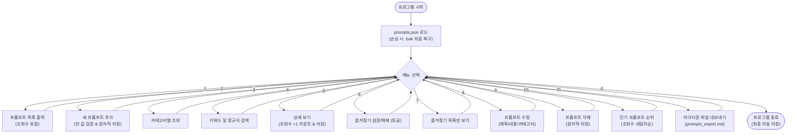

# 🚀 나만의 프롬프트 관리 프로그램

AI 프롬프트를 효율적으로 관리하고 저장하는 파이썬 CLI 도구입니다.
이 프로젝트는 Python과 Git/GitHub를 활용한 소프트웨어 개발 및 버전 관리 학습을 위해 제작되었으며, **기본 요구사항은 물론 추가 기능(원자적 JSON 영속화, 자동 백업/복구, 카테고리별 Markdown 내보내기, 조회수 기록, 인기 순위 정렬, 정규식 검색)까지 전면 구현**되어 있습니다.

---

## 📌 프로그램 개요

AI 도구를 자주 사용하다 보면 유용한 프롬프트를 체계적으로 저장하고 재사용하고 싶을 때가 많습니다.
이 프로그램은 프롬프트를 **카테고리별로 분류**하고, **키워드 및 정규표현식 검색**, **즐겨찾기**, **수정/삭제**, **조회수 기반 인기 순위**, **원자적 JSON 영속화 및 Markdown 내보내기** 기능으로 빠르고 유연하게 관리할 수 있도록 도와줍니다.

### 주요 특징
- 📂 **카테고리별 프롬프트 분류**: 텍스트 생성 / 이미지 생성 / 영상 생성 / 자동화 / 개발 / 기타 및 사용자 직접 추가
- 🔍 **키워드 및 정규식(`r:`) 검색**: 대소문자 무관 부분 일치 및 정규표현식 패턴 검색 지원
- ⭐ **즐겨찾기 관리**: 원클릭 즐겨찾기 등록/해제 토글 및 모아보기
- ✏️ **프롬프트 수정 & 삭제**: 기존 프롬프트의 속성 변경 및 안전한 삭제 (완전한 CRUD 구현)
- 💾 **[추가 기능] 원자적 JSON 영속화**: `prompts.json` 임시 파일 교체 방식의 원자적 쓰기(Atomic Write)
- 🛡️ **[추가 기능] 자동 백업 및 장애 복구**: 변경 시 `prompts.json.bak` 백업 생성 및 손상 시 자동 복구
- 📑 **[추가 기능] 카테고리별 Markdown 내보내기**: 전체 프롬프트를 카테고리별 구조화된 `prompts_export.md`로 내보내기
- 👁️ **[추가 기능] 조회수(사용 횟수) 자동 기록**: 프롬프트 상세 보기 시 조회수 1 증가 및 영속화
- 🏆 **[추가 기능] 인기 프롬프트 Top 정렬**: 조회수 기준 내림차순 정렬 랭킹 목록 제공
- 🕐 **타임스탬프 자동 기록**: 등록 및 수정 시 일시 자동 기록
- ⚠️ **견고한 예외 처리**: 최상위 `try-except-finally` 래핑으로 강제 종료(`Ctrl+C`) 시에도 데이터 100% 보존

---

## 🗂️ 파일 구조

```text
prompt_manager/
├── .github/
│   └── workflows/
│       └── ci.yml            # GitHub Actions CI 파이프라인 (Python 3.10~3.13 테스트)
├── Screenshots/              # 실행 화면 및 Git 이력 캡처 이미지
├── .gitignore                # Git 제외 대상 설정 파일
├── FILE_STRUCTURE.md         # 프로젝트 구조 설명 문서
├── README.md                 # 프로젝트 개요 및 사용법 (현재 파일)
├── A1-1_Summary.md           # 미션 결과 요약, 평가문항 및 추가 기능 심층 기술 답변서
├── test_prompt_manager.py    # 단위 테스트 및 회귀 테스트 스위트
├── prompts.json              # [추가 기능] 데이터 영속화 JSON 저장소
├── prompts.json.bak          # [추가 기능] 파일 손상 방지용 자동 백업본
├── prompts_export.md         # [추가 기능] 카테고리별 마크다운 내보내기 결과 파일
└── main.py                   # 프로그램 메인 실행 파일 (전체 기능 구현)
```

---

## ⚙️ 기능 설명 (CRUD & 추가 기능 완비)

| 번호 | 기능 | 설명 | 분류 |
|:---:|:---|:---|:---:|
| 1 | 프롬프트 목록 | 저장된 전체 프롬프트를 번호/카테고리/제목/조회수/등록일/즐겨찾기(★)와 함께 출력 | Read |
| 2 | 프롬프트 추가 | 제목, 내용, 카테고리를 입력받아 신규 등록 (빈 값 검증, 타임스탬프 자동 생성, 원자적 JSON 저장) | Create |
| 3 | 카테고리별 조회 | 원하는 카테고리를 선택하여 해당 분류의 프롬프트만 필터링 출력 | Read |
| 4 | 프롬프트 검색 | 키워드 부분 일치 또는 정규표현식(`r:패턴`) 검색 (대소문자 무관) | Read (추가 기능) |
| 5 | 상세 보기 | 번호 선택 시 프롬프트 본문 확인 및 **조회수 +1 자동 증가** | Read (추가 기능) |
| 6 | 즐겨찾기 관리 | 프롬프트의 즐겨찾기 여부를 On/Off 토글 (★ 등록 / 해제, JSON 저장) | Update |
| 7 | 즐겨찾기 목록 | 즐겨찾기(★)로 지정된 프롬프트만 모아서 출력 | Read |
| 8 | 프롬프트 수정 | 기존 프롬프트의 제목, 내용, 카테고리 수정 (Enter 입력 시 기존 값 유지, JSON 저장) | Update |
| 9 | 프롬프트 삭제 | 번호를 입력받아 해당 프롬프트를 안전하게 삭제 (JSON 동기화) | Delete |
| 10 | 인기 프롬프트 | 조회수(사용 횟수) 기준 내림차순 정렬된 Top 순위 목록 출력 | Read (추가 기능) |
| 11 | 마크다운 내보내기 | 전체 프롬프트를 카테고리별로 묶어 `prompts_export.md` 파일로 내보내기 | Export (추가 기능) |
| 0 | 종료 | 변경사항 최종 JSON 자동 저장 및 안전 종료 | - |

---

## 💾 데이터 안정성 및 영속화 아키텍처

### 1. 원자적 저장 방식 (Atomic Write)
일반적인 파일 덮어쓰기(`open("prompts.json", "w")`) 도중 정전이나 강제 종료가 발생하면 파일 내용이 비어버리는(0 Byte) 치명적인 데이터 손상이 발생할 수 있습니다.
- **해결책**: 데이터를 임시 파일(`prompts.json.tmp`)에 먼저 완전히 기록한 뒤, OS 레벨의 원자적 연산인 `os.replace()`를 통해 교체합니다.
- 파일 쓰기 도중 프로세스가 비정상 종료되어도 기존의 `prompts.json` 원본은 100% 무결하게 유지됩니다.

### 2. 자동 백업 및 장애 복구 (Backup & Auto-Recovery)
- 저장 직전 기존 정상 파일을 `prompts.json.bak`으로 자동 복사하여 이중화합니다.
- 프로그램 시작 시 `prompts.json` 파일이 손상되었거나 파싱 오류(`json.JSONDecodeError`)가 발생할 경우, 백업 파일(`prompts.json.bak`)을 감지하여 자동으로 복구합니다.

### 3. 최상위 예외 래핑 (Top-level Exception Wrap)
- `main()` 루프 전체를 `try ... except KeyboardInterrupt ... finally: save_prompts()` 구조로 래핑하여 사용자가 언제든 `Ctrl+C`로 강제 중단하더라도 메모리 상의 최신 데이터가 누락 없이 디스크에 동기화됩니다.

---

## 🔍 검색 기능 및 대용량 최적화 방안

### 1. 정규표현식(Regex) 검색 지원
- `r:` 접두사를 붙여 정규식 패턴 검색이 가능합니다.
  - 예: `r:AI|LLM` (AI 또는 LLM 포함)
  - 예: `r:^제품.*이미지` (제품으로 시작하고 이미지가 포함된 제목)

### 2. 대용량 환경을 위한 사전 처리(Preprocessing) 및 역색인(Inverted Index) 전략
프롬프트 데이터가 수만 건 이상으로 확장될 경우를 대비한 최적화 아키텍처:
1. **사전 소문자화(Pre-lowering) 캐싱**: 매 검색 시점마다 `lower()`를 반복 연산하지 않고, 데이터 로드/저장 시 소문자 검색용 코퍼스(`_search_text`)를 메모리에 미리 캐싱.
2. **역색인(Inverted Index) 구축**:
   - 프롬프트 본문을 토큰화(단어 분리)하여 `단어 -> set(프롬프트ID)` 형태의 해시맵을 구축.
   - 키워드 검색 시 $O(N \times L)$ 선형 순회가 아닌 $O(1)$의 집합 교집합 연산으로 고속 처리.
3. **전문 검색 엔진 연동**: 데이터 규모가 수십만 건에 이를 경우 SQLite FTS5(Full Text Search) 또는 Whoosh / Elasticsearch 도입.

---

## 📋 브랜치 병합 기준 체크리스트 (Merge Criteria & CI)

안정적인 `main` 브랜치를 유지하기 위해 다음과 같은 병합 기준 및 CI 파이프라인을 운영합니다:

```text
[ ] 1. 문법 및 정적 분석 통과 (python -m py_compile main.py)
[ ] 2. 자동화 테스트 스위트 전수 통과 (python -m unittest test_prompt_manager.py)
[ ] 3. 필수 CRUD 및 추가 기능(검색, 랭킹, MD 내보내기) 기능 회귀 검증
[ ] 4. 데이터 저장 무결성 및 백업 복구 동작 확인
[ ] 5. README.md 및 A1-1_Summary.md 문서 최신화 완료
[ ] 6. GitHub Actions CI 파이프라인 All Green (Python 3.10 ~ 3.13)
```

---

## 🗺️ 프로그램 흐름도



---

## 💻 프로그램 실행 및 테스트 방법

### 1. 프로그램 실행
```bash
python main.py
```

### 2. 자동화 단위 테스트 실행
```bash
python -m unittest test_prompt_manager.py
```

---

## 🛠️ 기술 스택

| 항목 | 내용 |
|:---|:---|
| **Language** | Python 3.13+ (3.10 이상 완벽 호환) |
| **Persistence** | 원자적 JSON (`prompts.json`, 백업 `prompts.json.bak`) |
| **Export Format** | Markdown (`.md`) 카테고리별 포맷팅 |
| **CI / Automation** | GitHub Actions (`.github/workflows/ci.yml`), `unittest` |
| **VCS** | Git, GitHub |
| **Branch Strategy** | `main` (안정 버전), `feature/ui-update` (UI 고도화 브랜치) |

---

## 📅 업데이트 기록

- **v1.0.0**: 초기 버전 출시 (기본 CRUD, 목록 및 검색, CLI 메뉴 구조)
- **v1.1.0**: `feature/ui-update` 브랜치 병합 (메뉴 디자인 개선, 타임스탬프 자동화, 즐겨찾기 토글)
- **v1.2.0**: 프롬프트 수정 기능(`modify_prompt`) 및 동적 사용자 카테고리 추가 지원
- **v1.3.0**: 프롬프트 삭제 기능(`delete_prompt`) 구현, 빈 값 검증 및 UTF-8 인코딩 처리 강화
- **v1.4.0**: JSON 영속화, 카테고리별 마크다운 내보내기, 조회수 카운팅 및 Top 랭킹 정렬 구현
- **v1.5.0**:
  - 원자적 파일 저장(Atomic Write) 및 파일 손상 대비 자동 백업/복구 시스템 구축
  - 최상위 예외 래핑(Graceful Exit)을 통한 비정상 종료 시 데이터 100% 보존
  - 정규표현식(`r:`) 검색 기능 추가 및 대용량 사전 색인 최적화 방안 제시
  - 단위 테스트 스위트(`test_prompt_manager.py`) 및 GitHub Actions CI 워크플로우 구축
