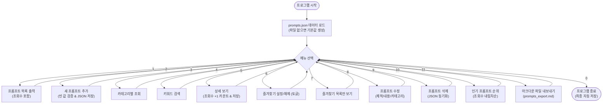

# 🚀 나만의 프롬프트 관리 프로그램

AI 프롬프트를 효율적으로 관리하고 저장하는 파이썬 CLI 도구입니다.
이 프로젝트는 Python과 Git/GitHub를 활용한 소프트웨어 개발 및 버전 관리 학습을 위해 제작되었으며, **기본 요구사항은 물론 추가 기능(JSON 영속화, 카테고리별 Markdown 내보내기, 조회수 기록, 인기 순위 정렬)까지 전면 구현**되어 있습니다.

---

## 📌 프로그램 개요

AI 도구를 자주 사용하다 보면 유용한 프롬프트를 체계적으로 저장하고 재사용하고 싶을 때가 많습니다.
이 프로그램은 프롬프트를 **카테고리별로 분류**하고, **키워드 검색**, **즐겨찾기**, **수정/삭제**, **조회수 기반 인기 순위**, **JSON 영속화 및 Markdown 내보내기** 기능으로 빠르고 유연하게 관리할 수 있도록 도와줍니다.

### 주요 특징
- 📂 **카테고리별 프롬프트 분류**: 텍스트 생성 / 이미지 생성 / 영상 생성 / 자동화 / 개발 / 기타 및 사용자 직접 추가
- 🔍 **제목 + 내용 동시 키워드 검색**: 대소문자 구분 없는 부분 일치 검색
- ⭐ **즐겨찾기 관리**: 원클릭 즐겨찾기 등록/해제 토글 및 모아보기
- ✏️ **프롬프트 수정 & 삭제**: 기존 프롬프트의 속성 변경 및 안전한 삭제 (완전한 CRUD 구현)
- 💾 **[추가 기능] JSON 파일 영속화**: `prompts.json`을 통한 프로그램 종료 후에도 데이터 자동 보존/복원
- 📑 **[추가 기능] 카테고리별 Markdown 내보내기**: 전체 프롬프트를 카테고리별 구조화된 `prompts_export.md`로 내보내기
- 👁️ **[추가 기능] 조회수(사용 횟수) 자동 기록**: 프롬프트 상세 보기 시 조회수 1 증가 및 영속화
- 🏆 **[추가 기능] 인기 프롬프트 Top 정렬**: 조회수 기준 내림차순 정렬 랭킹 목록 제공
- 🕐 **타임스탬프 자동 기록**: 등록 및 수정 시 일시 자동 기록
- ⚠️ **견고한 예외 처리**: 빈 값 입력 방지, 번호 범위 검증, 문자열/정수 예외 및 UTF-8 인코딩 지원

---

## 🗂️ 파일 구조

```text
prompt_manager/
├── Screenshots/          # 실행 화면 및 Git 이력 캡처 이미지
├── .gitignore            # Git 제외 대상 설정 파일
├── FILE_STRUCTURE.md     # 파일 구조 설명 문서
├── README.md             # 프로젝트 개요 및 사용법 (현재 파일)
├── A1-1_Summary.md       # 미션 결과 요약, 평가문항 및 추가 기능 심층 기술 답변서
├── prompts.json          # [추가 기능] 데이터 영속화 JSON 저장소
├── prompts_export.md     # [추가 기능] 카테고리별 마크다운 내보내기 결과 파일
└── main.py               # 프로그램 메인 실행 파일 (전체 기능 구현)
```

---

## ⚙️ 기능 설명 (CRUD & 추가 기능 완비)

| 번호 | 기능 | 설명 | 분류 |
|:---:|:---|:---|:---:|
| 1 | 프롬프트 목록 | 저장된 전체 프롬프트를 번호/카테고리/제목/조회수/등록일/즐겨찾기(★)와 함께 출력 | Read |
| 2 | 프롬프트 추가 | 제목, 내용, 카테고리를 입력받아 신규 등록 (빈 값 검증, 타임스탬프 자동 생성, JSON 저장) | Create |
| 3 | 카테고리별 조회 | 원하는 카테고리를 선택하여 해당 분류의 프롬프트만 필터링 출력 | Read |
| 4 | 키워드 검색 | 제목 또는 내용에 검색어가 포함된 프롬프트 탐색 (대소문자 무관) | Read |
| 5 | 상세 보기 | 번호 선택 시 프롬프트 본문 확인 및 **조회수 +1 자동 증가** | Read (추가 기능) |
| 6 | 즐겨찾기 관리 | 프롬프트의 즐겨찾기 여부를 On/Off 토글 (★ 등록 / 해제, JSON 저장) | Update |
| 7 | 즐겨찾기 목록 | 즐겨찾기(★)로 지정된 프롬프트만 모아서 출력 | Read |
| 8 | 프롬프트 수정 | 기존 프롬프트의 제목, 내용, 카테고리 수정 (Enter 입력 시 기존 값 유지, JSON 저장) | Update |
| 9 | 프롬프트 삭제 | 번호를 입력받아 해당 프롬프트를 안전하게 삭제 (JSON 동기화) | Delete |
| 10 | 인기 프롬프트 | 조회수(사용 횟수) 기준 내림차순 정렬된 Top 순위 목록 출력 | Read (추가 기능) |
| 11 | 마크다운 내보내기 | 전체 프롬프트를 카테고리별로 묶어 `prompts_export.md` 파일로 내보내기 | Export (추가 기능) |
| 0 | 종료 | 변경사항 최종 JSON 자동 저장 및 프로그램 종료 | - |

---

## 🗺️ 프로그램 흐름도



---

## 💻 프로그램 실행 방법

### 1단계 - 프로그램 실행

```bash
python main.py
```

> ✅ 실행 시 `prompts.json` 파일에서 데이터를 자동 로드하며, 아래 대화형 메뉴가 출력됩니다.

```text
======================================
        나만의 프롬프트 관리자
---------------------------------------------
[1]  프롬프트 목록
[2]  프롬프트 추가
[3]  카테고리별 조회
[4]  프롬프트 검색
[5]  프롬프트 상세 보기 (조회수 +1)
[6]  즐겨찾기 관리
[7]  즐겨찾기 목록
[8]  프롬프트 수정
[9]  프롬프트 삭제
[10] 인기 프롬프트 (조회수 Top 순위)
[11] 마크다운(.md)으로 내보내기
[0]  종료 (자동 저장)
---------------------------------------------
선택:
```

---

### 2단계 - 추가 기능 사용 예시

**1) 상세 보기 및 조회수 카운팅 ([5])**
```text
선택: 5
상세히 볼 프롬프트 번호: 1

--- 상세 정보 ---
제목: LLM 기반 회의록 자동화
카테고리: 자동화
등록/수정일: 2026-08-12 09:15:00
조회수: 1회
즐겨찾기: ★
-------------------------
내용:
회의 녹취록을 입력하면 안건, 결정사항, 실행 과제로 요약해줘.
-------------------------
```

**2) 인기 프롬프트 순위 보기 ([10])**
```text
선택: 10

--- 🏆 인기 프롬프트 Top 목록 (조회수 기준) ---
순위   | 조회수    | 카테고리       | 제목                     | 즐겨찾기
-----------------------------------------------------------------
1    | 1회     | 자동화        | LLM 기반 회의록 자동화         | ★
2    | 0회     | 영상 생성      | 날으는 자동차 영상 제작          |  
3    | 0회     | 자동화        | 최신 논문 요약 메일 발송         | ★
...
```

**3) 마크다운으로 내보내기 ([11])**
```text
선택: 11

✅ 전체 프롬프트가 'prompts_export.md'(으)로 성공적으로 내보내졌습니다!
```

---

## 🛠️ 기술 스택

| 항목 | 내용 |
|:---|:---|
| **Language** | Python 3.13+ (3.10 이상 완벽 호환) |
| **Persistence** | JSON (`json` 표준 라이브러리) |
| **Export Format** | Markdown (`.md`) 카테고리별 포맷팅 |
| **VCS** | Git, GitHub |
| **Branch Strategy** | `main` (안정 버전), `feature/ui-update` (UI 고도화 브랜치) |

---

## 📅 업데이트 기록

- **v1.0.0**: 초기 버전 출시 (기본 CRUD, 목록 및 검색, CLI 메뉴 구조)
- **v1.1.0**: `feature/ui-update` 브랜치 병합 (메뉴 디자인 개선, 타임스탬프 자동화, 즐겨찾기 토글)
- **v1.2.0**: 프롬프트 수정 기능(`modify_prompt`) 및 동적 사용자 카테고리 추가 지원
- **v1.3.0**: 프롬프트 삭제 기능(`delete_prompt`) 구현, 빈 값 검증 및 UTF-8 인코딩 처리 강화
- **v1.4.0**:
  - **데이터 영속화 및 내보내기 구현**: JSON 데이터 영속화(`prompts.json` 자동 로드/저장) 및 카테고리별 마크다운 내보내기(`prompts_export.md`)
  - **조회수 및 랭킹 기능 구현**: 상세 보기 시 사용 횟수(조회수) 자동 카운팅 및 조회수 기준 인기 순위(Top 목록) 기능 탑재
