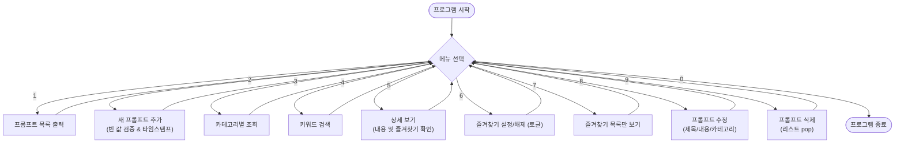

# 🚀 나만의 프롬프트 관리 프로그램

AI 프롬프트를 효율적으로 관리하고 저장하는 파이썬 CLI 도구입니다.
이 프로젝트는 Python과 Git/GitHub를 활용한 소프트웨어 개발 및 버전 관리 학습을 위해 제작되었습니다.

---

## 📌 프로그램 개요

AI 도구를 자주 사용하다 보면 유용한 프롬프트를 체계적으로 저장하고 재사용하고 싶을 때가 많습니다.
이 프로그램은 그런 프롬프트를 **카테고리별로 분류**하고, **키워드 검색**과 **즐겨찾기**, **수정 및 삭제** 기능으로 빠르고 유연하게 관리할 수 있도록 도와줍니다.

### 주요 특징
- 📂 **카테고리별 프롬프트 분류**: 텍스트 생성 / 이미지 생성 / 영상 생성 / 자동화 / 개발 / 기타 및 사용자 직접 추가
- 🔍 **제목 + 내용 동시 키워드 검색**: 대소문자 구분 없는 부분 일치 검색
- ⭐ **즐겨찾기 관리**: 원클릭 즐겨찾기 등록/해제 토글 및 모아보기
- ✏️ **프롬프트 수정 & 삭제**: 기존 프롬프트의 속성 변경 및 삭제를 통한 완전한 CRUD 구현
- 🕐 **타임스탬프 자동 기록**: 등록 및 수정 시 일시 자동 기록
- ⚠️ **견고한 예외 처리**: 빈 값 입력 방지, 번호 범위 검증, 문자열/정수 예외 및 UTF-8 인코딩 지원

---

## 🗂️ 파일 구조

```text
prompt_manager/
├── Screenshots/          # 실행 화면 및 Git 이력 캡처 이미지
├── .gitignore            # Git 제외 대상 설정 파일
├── FILE_STRUCTURE.md     # 파일 구조 설명 문서
├── README.md             # 프로젝트 개요 및 사용법 (현재 파일)
├── A1-1_Summary.md       # 미션 결과 요약 및 평가문항 심층 답변서
└── main.py               # 프로그램 메인 실행 파일 (전체 기능 구현)
```

---

## ⚙️ 기능 설명 (CRUD 지원)

| 번호 | 기능 | 설명 | CRUD 분류 |
|:---:|:---|:---|:---:|
| 1 | 프롬프트 목록 | 저장된 전체 프롬프트를 번호/카테고리/제목/등록일/즐겨찾기(★)와 함께 출력 | Read |
| 2 | 프롬프트 추가 | 제목, 내용, 카테고리를 입력받아 신규 프롬프트 등록 (빈 값 검증 및 타임스탬프 자동 생성) | Create |
| 3 | 카테고리별 조회 | 원하는 카테고리를 선택하여 해당 분류의 프롬프트만 필터링 출력 | Read |
| 4 | 키워드 검색 | 제목 또는 내용에 검색어가 포함된 프롬프트 탐색 (대소문자 무관) | Read |
| 5 | 상세 보기 | 번호 선택 시 프롬프트의 전체 본문 내용 및 메타데이터 확인 | Read |
| 6 | 즐겨찾기 관리 | 프롬프트의 즐겨찾기 여부를 On/Off 토글 (★ 등록 / 해제) | Update |
| 7 | 즐겨찾기 목록 | 즐겨찾기(★)로 지정된 프롬프트만 모아서 출력 | Read |
| 8 | 프롬프트 수정 | 기존 프롬프트의 제목, 내용, 카테고리 수정 (Enter 입력 시 기존 값 유지) | Update |
| 9 | 프롬프트 삭제 | 번호를 입력받아 해당 프롬프트를 안전하게 삭제 | Delete |
| 0 | 종료 | 프로그램 종료 및 안내 메시지 출력 | - |

---

## 🗺️ 프로그램 흐름도



---

## 💻 프로그램 실행 방법

### 1단계 - 프로그램 실행

```bash
python main.py
```

> ✅ 실행 성공 시 아래와 같은 대화형 메뉴 화면이 출력됩니다.

```text
==============================
   나만의 프롬프트 관리자
----------------------------------------
[1] 프롬프트 목록
[2] 프롬프트 추가
[3] 카테고리별 조회
[4] 프롬프트 검색
[5] 프롬프트 상세 보기
[6] 즐겨찾기 관리
[7] 즐겨찾기 목록
[8] 프롬프트 수정
[9] 프롬프트 삭제
[0] 종료
----------------------------------------
선택:
```

---

### 2단계 - 주요 사용 예시

**1) 프롬프트 추가하기 ([2])**
```text
선택: 2

--- 새 프롬프트 등록 ---
제목을 입력하세요: 유튜브 썸네일 문구 생성
내용을 입력하세요: 조회수를 높이는 유튜브 썸네일 문구 5개를 추천해줘.

[카테고리 목록]
0. 직접 입력 (새 카테고리 추가)
1. 텍스트 생성
2. 이미지 생성
3. 영상 생성
4. 페르소나
5. 자동화
6. 개발
7. 기타

카테고리 번호 선택: 1

✅ '유튜브 썸네일 문구 생성' 등록 완료! (시간: 2026-08-12 10:30:00)
```

**2) 키워드 검색하기 ([4])**
```text
선택: 4

검색할 키워드를 입력하세요: 자동화

'자동화' 검색 결과:
--------------------------------------------------
[자동화] LLM 기반 회의록 자동화
[자동화] 최신 논문 요약 메일 발송
```

**3) 프롬프트 삭제하기 ([9])**
```text
선택: 9

삭제할 프롬프트 번호: 6
✅ '파이썬 코드 리뷰' 프롬프트가 삭제되었습니다.
```

---

## 🛠️ 기술 스택

| 항목 | 내용 |
|:---|:---|
| **Language** | Python 3.13+ (3.10 이상 완벽 호환) |
| **Library** | 표준 라이브러리만 사용 (`datetime`, `sys`) |
| **Data Structure** | 복합 자료구조 `List[Dict]` 기반 |
| **VCS** | Git, GitHub |
| **Branch Strategy** | `main` (배포 안정 브랜치), `feature/ui-update` (UI 기능 고도화 브랜치) |

---

## ✅ 테스트 및 검증 결과

1. **Python 버전 호환성**: Python 3.10 이상(3.13) 정상 동작 검증 완료.
2. **전체 CRUD 동작**: 추가(Create), 목록/조회/검색(Read), 수정/즐겨찾기(Update), 삭제(Delete) 동작 검증 완료.
3. **입력 유효성 검증**: 메뉴 외 번호, 빈 제목/내용 입력, 정수형 변환 오류(`ValueError`), 인덱스 범위 초과(`IndexError`) 방어.
4. **UTF-8 인코딩 안전성**: Windows 콘솔 및 파이프라인에서 한글 및 이모지 깨짐 방지 처리 완료.

---

## 📅 업데이트 기록

- **v1.0.0**: 초기 버전 출시 (기본 CRUD, 목록 및 검색, CLI 메뉴 구조)
- **v1.1.0**: `feature/ui-update` 브랜치 병합 (메뉴 디자인 개선, 타임스탬프 자동화, 즐겨찾기 토글)
- **v1.2.0**: 프롬프트 수정 기능(`modify_prompt`) 및 동적 사용자 카테고리 추가 지원
- **v1.3.0**: 프롬프트 삭제 기능(`delete_prompt`) 구현으로 완전한 CRUD 완성, 입력 빈 값 검증 및 UTF-8 인코딩 처리 강화
